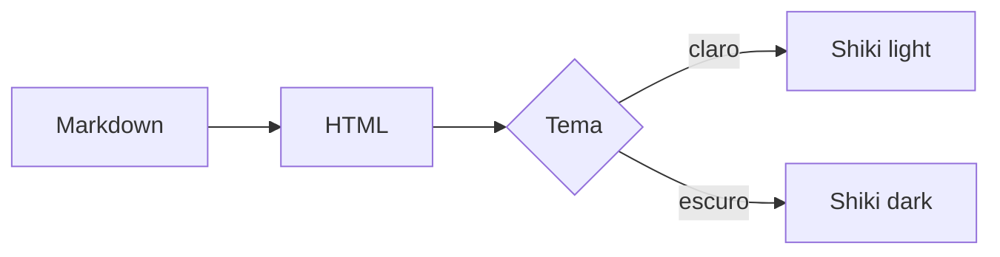
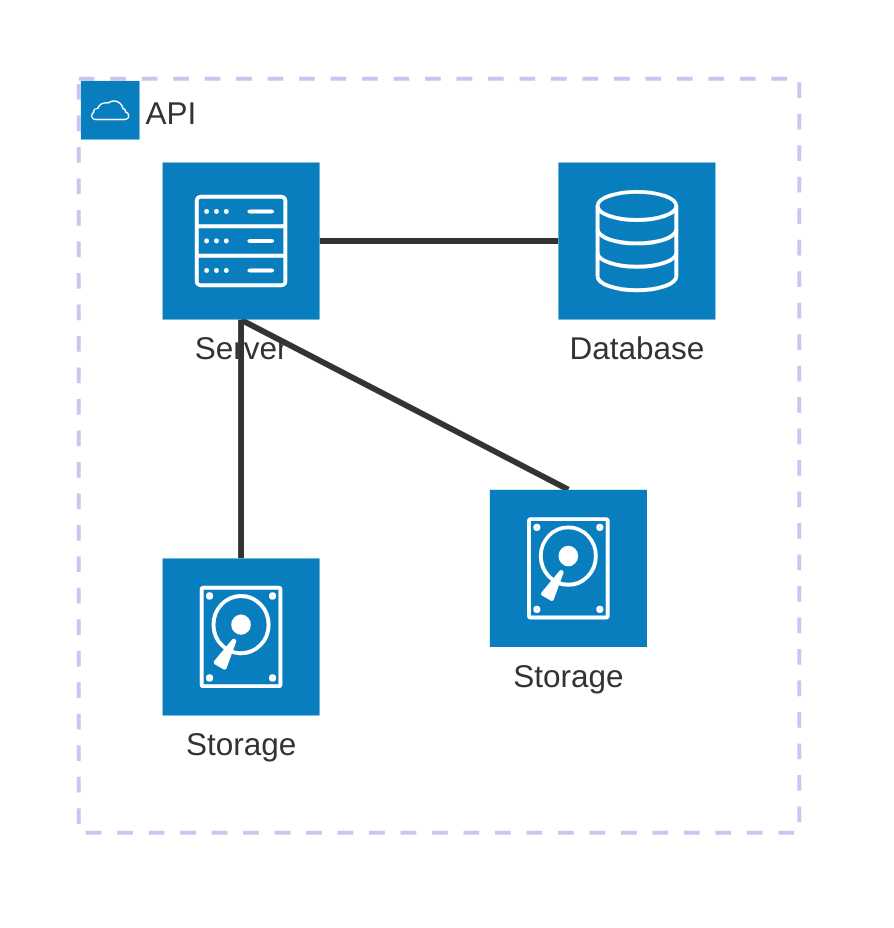

# Referência de preview

Parágrafo de abertura com **negrito**, *itálico*, `código inline` e um [link](https://example.com).
Também há ~~texto removido~~ para cobrir o GFM.

## Seção com tabela e tarefas

- [x] Frontmatter com metadados
- [ ] Validar o baseline visual
- [ ] Repetir os cenários depois da refatoração

| Coluna | Tipo | Exemplo |
| --- | --- | --- |
| `title` | string | Referência md-preview |
| `tags` | array | fixture, baseline |
| `author` | objeto | name, role |

### Subseção com código

```ts
interface PreviewInput {
  title: string;
  body: string;
  themeName: string;
}

export function previewLabel(input: PreviewInput): string {
  return `${input.title} (${input.themeName})`;
}
```

Bloco sem linguagem:

```
texto simples
  com indentação preservada
```

Imagem local:


Nota de rodapé com referência.[^1]

## Diagramas Mermaid





[^1]: Texto da nota de rodapé usado na fixture de referência.
