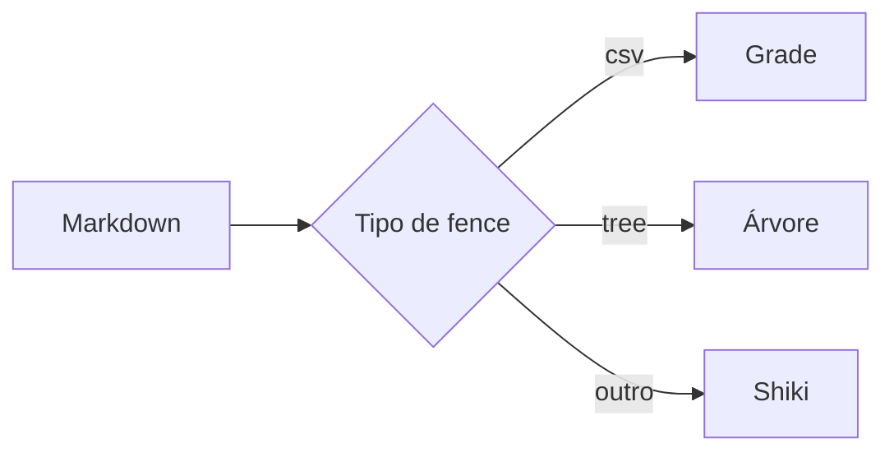
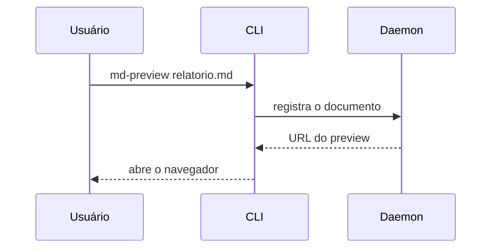

# Showcase do md-preview

Uma fixture com um exemplo curto de cada recurso do renderizador.

## Frontmatter

O bloco YAML no topo vira um cartão `<details>` e `title` também nomeia a aba.

```yaml
---
title: Relatório semanal
date: 2026-03-14
tags: [produto, pesquisa]
author:
  name: Ana Ribeiro
  role: analista
---
```

## Títulos e sumário

Títulos de `h1` a `h6` recebem `id` e aparecem no sumário lateral.

### Nível três

Texto da subseção.

#### Nível quatro

Texto da subseção.

## Listas

Listas ordenadas, não ordenadas e aninhadas.

- Documento
  - Frontmatter
  - Corpo
- Interface
  1. Sumário
  2. Recent

## Tarefas

Task lists viram checkboxes somente leitura.

- [x] Registrar a fixture no daemon
- [x] Revisar o tema claro
- [ ] Revisar o tema escuro
- [ ] Conferir o sumário em tela estreita

## Citação

Blockquotes preservam parágrafos e formatação inline.

> O preview é renderizado no servidor; o navegador cuida do sumário, das tabelas e dos diagramas.
>
> Salvar o arquivo recarrega a página aberta.

## Linha horizontal

Separa blocos de conteúdo.

---

## Texto inline

Ênfase, riscado e código inline.

Parágrafo com **negrito**, *itálico*, ~~trecho removido~~ e `const preview = true`.

## Links

Links Markdown, autolinks e URLs soltas (linkify).

- [Documentação do CommonMark](https://commonmark.org/)
- Autolink: <https://example.com/equipe>
- URL solta: https://example.com/painel

## Tabela GFM

Toda tabela GFM vira uma grade interativa; o alinhamento vem dos dois-pontos.

| Recurso | Suporte | Documentos |
| :--- | :---: | ---: |
| Tabelas | Sim | 128 |
| CSV | Sim | 14 |
| Mermaid | Sim | 9 |

## Tabela interativa

Grade com funil por coluna, pesquisa, ordenação, pivô, cópia e tela cheia.

| Contrato | Cliente | Regional | Valor | Reajuste | Ativos | Última revisão | Situação |
| :--- | :--- | :---: | ---: | ---: | ---: | :---: | :---: |
| [CT-2026-001](https://example.com/contratos/CT-2026-001) | Instituto Aurora | Sudeste | R$ 128.450,00 | 4,8% | 32 | 12/03/2026 | Ativo |
| [CT-2026-002](https://example.com/contratos/CT-2026-002) | Fundação Horizonte | Nordeste | R$ 98.320,50 | 3,2% | 18 | 05/04/2026 | Ativo |
| [CT-2025-087](https://example.com/contratos/CT-2025-087) | Rede Brisa | Sul | R$ 74.900,00 | | 12 | 18/04/2026 | Em revisão |
| [CT-2026-003](https://example.com/contratos/CT-2026-003) | Colégio Ipê Amarelo | Sudeste | R$ 56.780,00 | 6,1% | 24 | 22/04/2026 | Ativo |
| [CT-2025-064](https://example.com/contratos/CT-2025-064) | Associação Vereda | Centro-Oeste | R$ 41.250,00 | 2,5% | 9 | 29/04/2026 | Suspenso |
| [CT-2026-004](https://example.com/contratos/CT-2026-004) | Clínica Bem Viver | Norte | R$ 35.900,00 | 5,0% | 15 | 03/05/2026 | Ativo |
| [CT-2026-005](https://example.com/contratos/CT-2026-005) | Transportes Vila Nova | Sudeste | R$ 212.000,00 | 7,3% | 48 | 09/05/2026 | Ativo |
| [CT-2024-102](https://example.com/contratos/CT-2024-102) | Gráfica Ponto Certo | Sul | R$ 19.480,90 | | 6 | 14/05/2026 | Encerrado |
| [CT-2026-007](https://example.com/contratos/CT-2026-007) | Condomínio Pedra Clara | Nordeste | R$ 63.780,00 | 4,4% | 21 | 17/05/2026 | Ativo |
| [CT-2026-008](https://example.com/contratos/CT-2026-008) | Mercado Bom Dia | Centro-Oeste | R$ 87.600,00 | 3,9% | 28 | 21/05/2026 | Em revisão |

A grade é somente leitura: não há edição de célula.[^tabela] Duplo clique (ou
`Enter` na célula ativa) abre o conteúdo completo na lightbox da tabela,
inclusive quando a coluna está estreita e o texto aparece truncado; a mesma
lightbox oferece zoom, redimensionamento e arraste. Em **Widgets → Tabelas**, a
**Quebra automática de linhas** troca o truncamento por células de várias
linhas.

## Fence csv

O separador é detectado na primeira linha; aspas aceitam `;` e quebras de linha.

```csv
codigo;cliente;valor;reajuste;data;situacao
CT-2026-001;Instituto Aurora;128450,00;4,8;12/03/2026;Ativo
CT-2026-002;"Rede Brisa; Sul";98320,50;3,2;05/04/2026;"Aditivo em análise:
aguardando assinatura"
CT-2026-003;Colégio Ipê Amarelo;56780,00;;22/04/2026;Ativo
CT-2026-004;Fundação Horizonte;74900,00;6,1;18/04/2026;Em revisão
```

## Fence tree

Árvore interativa com comentários depois de `#` e contadores por pasta.

```tree
md-preview
├── src
│   ├── core
│   │   ├── render.ts        # pipeline markdown-it
│   │   └── tables.ts        # grade e CSV
│   └── ui
│       └── table.ts         # filtros e pivot
├── docs
│   └── wiki-showcase.md     # esta fixture
└── package.json             # scripts e dependências

4 directories, 5 files
```

## Código

Blocos com Shiki usam o tema ativo; sem linguagem, o texto fica sem realce.

```ts
interface PreviewInput {
  title: string;
  body: string;
}

export function lineCount(input: PreviewInput): number {
  return input.body.split("\n").filter((line) => line.trim() !== "").length;
}
```

```bash
md-preview docs/fixtures/wiki-showcase.md
md-preview --theme github-dark relatorio.md
```

```json
{
  "theme": "auto",
  "loader": "dots",
  "zoomSensitivity": 1.35
}
```

```
saída bruta
  com espaços preservados
  e uma linha final
```

## Diff

Saída unificada com as visões Inline e Lado a lado.

```diff ts
diff --git a/src/core/render.ts b/src/core/render.ts
index 3f1c2a0..8b7d4e1 100644
--- a/src/core/render.ts
+++ b/src/core/render.ts
@@ -12,7 +12,8 @@ export function render(source: string) {
   const tokens = parse(source);
   if (tokens.length === 0) {
-    return "";
+    return null;
   }
+  return format(tokens);
 }
```

## Mermaid

Dois tipos de diagrama, desenhados no navegador com as cores do tema.





## Imagem relativa

Caminhos relativos são servidos a partir da pasta do documento.


## Links entre documentos

Links para um `.md` irmão abrem o preview do destino.

Veja a [fixture de referência](reference.md).

## HTML inline

Tags de formatação funcionam; scripts e handlers não executam.

Use <kbd>Ctrl</kbd> + <kbd>K</kbd> para abrir a pesquisa.

<details>
<summary>Detalhes</summary>

Conteúdo dentro de um `details` escrito em HTML.

</details>

## Raw

O botão Raw no topo mostra o source completo; fences `csv` e `tree` têm Raw próprio.[^raw]

## Limitações

- Não há edição de célula: a grade é somente leitura.
- Não há exportação em PDF.
- Admonitions e KaTeX não fazem parte do renderizador.
- Não há busca full-text entre documentos; a pesquisa filtra linhas da tabela.
- Filtros, ordenação, pivô e seleção não persistem ao recarregar.
- Um `.csv` só existe como fence; o arquivo não é registrado como documento.
- Tabelas GFM não têm Raw por bloco.
- Links `.md` em subpastas e imagens fora do diretório do documento não são reescritos.

[^tabela]: O pivô troca linhas e colunas; por isso a primeira coluna deve conter um rótulo.

[^raw]: O source viaja no payload da página e é realçado pelo daemon sob demanda.
