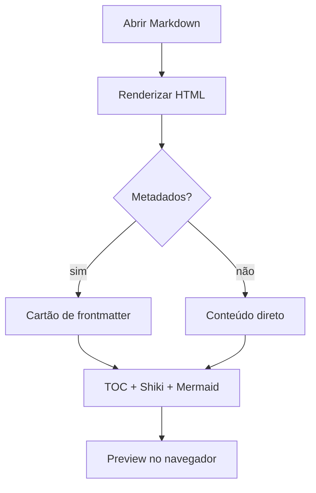

# Showcase do md-preview

Esta página reúne os recursos que aparecem nas capturas da wiki. Ela é
renderizada pelo próprio `md-preview`, sem conteúdo artificial: tudo abaixo
passa pelo mesmo pipeline usado no dia a dia. O objetivo é ter uma fixture
**longa o bastante** para gerar um sumário com rolagem e **variada o bastante**
para cobrir frontmatter, código, tabelas, tarefas, notas de rodapé, diagramas
e imagens relativas.

## Visão geral

- Renderização de Markdown com tabelas GFM e listas de tarefas.
- Realce de sintaxe com Shiki e diagramas Mermaid no tema ativo.
- Árvores de diretórios interativas a partir de blocos `tree`.

> O preview roda em um daemon local, escuta apenas em `127.0.0.1` e abre o
> navegador somente quando isso é pedido explicitamente.

## Formatação essencial

A lista de tarefas abaixo mistura itens concluídos e pendentes. Ela é renderizada
com caixas de seleção reais, sem JavaScript adicional.

- [x] Criar a fixture de showcase
- [x] Registrar o documento no daemon
- [ ] Revisar as capturas em tema claro
- [ ] Revisar as capturas em tema escuro

Este parágrafo existe para mostrar ~~trecho removido~~ ao lado de **ênfase
forte**, *ênfase simples* e `const preview = true`. O link para a
[documentação do Markdown](https://commonmark.org/) continua clicável.

| Recurso | Suporte | Observação |
| --- | --- | --- |
| Frontmatter | Sim | Cartão expansível no topo |
| Tabelas GFM | Sim | Cabeçalho com fundo próprio |
| Task lists | Sim | Itens marcados e desmarcados |
| Mermaid | Sim | Flowchart, sequence e architecture |
| Exportação em PDF | Não | Fora do escopo atual |

A nota de rodapé referencia o comportamento do daemon.[^daemon]

## Código com Shiki

### TypeScript

```ts
interface PreviewInput {
  title: string;
  body: string;
  themeName: "auto" | "github-light" | "github-dark";
}

export function describePreview(input: PreviewInput): string {
  const lines = input.body.split("\n").filter((line) => line.trim() !== "");
  return `${input.title} — ${lines.length} linhas em ${input.themeName}`;
}

const sample: PreviewInput = {
  title: "Showcase",
  body: "Markdown → HTML",
  themeName: "github-light",
};
console.log(describePreview(sample));
```

### Shell

```bash
# Captura reprodutível das imagens da wiki
MDPRV_PORT=8791 bun run capture
ls -lh ../../docs/wiki/static/img/features/*.png
```

### Texto puro

```
saída bruta
  com espaços preservados
  e uma linha final
```

## Diagrama Mermaid

O diagrama abaixo descreve o caminho de uma página até o navegador.



Clique no ícone de tela cheia para abrir o diagrama no lightbox, com zoom por
scroll e arraste para deslocar a imagem.

## Árvore de arquivos

O bloco `tree` vira uma árvore interativa. A raiz e o primeiro nível começam
abertos; pastas mais profundas começam recolhidas.

```tree
md-preview
├── src
│   ├── application
│   │   ├── cli
│   │   │   └── index.ts
│   │   └── daemon
│   │       └── index.ts
│   ├── core
│   │   └── markdown
│   │       └── render.ts
│   └── ui
│       └── main.ts
├── docs
│   ├── fixtures
│   │   └── wiki-showcase.md
│   └── wiki
│       └── static
├── themes
│   └── auto.json
└── package.json

10 directories, 12 files
```

## Imagem relativa

A imagem abaixo usa um caminho relativo ao próprio documento. O daemon resolve
o arquivo dentro da pasta registrada e bloqueia qualquer tentativa de escapar
dela.


O caminho `img/foto.png` é reescrito para uma rota interna do preview, sem
depender de servidor externo.

## Fluxo de captura

### Preparação e execução

O script garante que o daemon esteja disponível, registra esta fixture, a
referência e o README, e só então abre o Chromium headless. Cada captura navega
para a URL com o tema desejado, aguarda as fontes, o Shiki, o Mermaid e o
sumário, e desliga as animações antes de tirar a foto.

## Acessibilidade e atalhos

### Teclado

A tecla `z` alterna o modo zen, escondendo as barras laterais e os controles.
`Esc` fecha o lightbox do Mermaid. Com `prefers-reduced-motion: reduce`, as
transições de painel e os indicadores de carregamento deixam de animar.

## Limitações conhecidas

- Não há busca full-text entre documentos.
- Não há exportação para PDF.
- Admonitions e KaTeX não fazem parte do renderizador.
- O painel de recentes lista apenas documentos registrados no daemon atual.

## Próximos passos

1. Manter esta fixture alinhada aos recursos realmente entregues.
2. Reexecutar as capturas sempre que um tema ou componente mudar.

[^daemon]: O daemon grava um arquivo de estado com PID, porta e token, e encerra
    sozinho depois do período de inatividade configurado.
